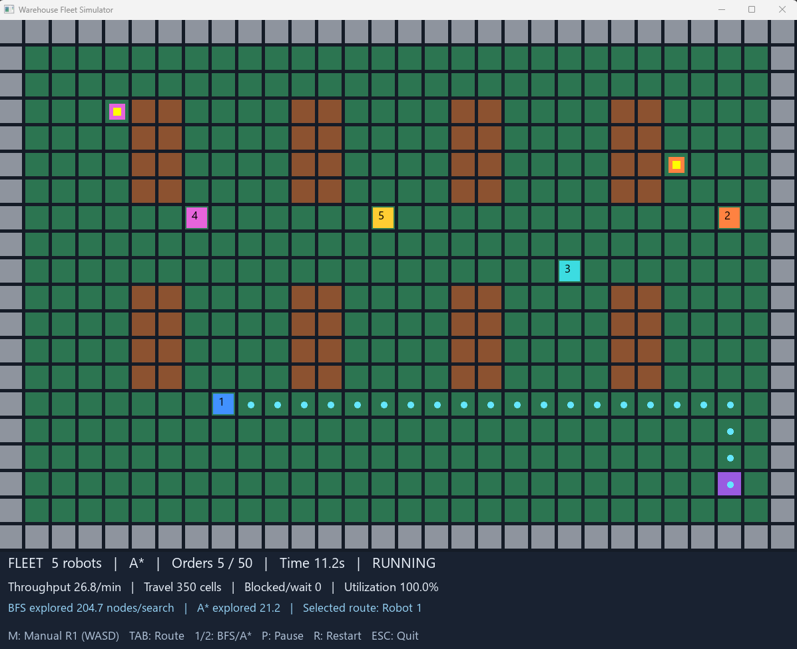

# Warehouse Fleet Simulator

A C++17 warehouse simulation built with SFML 3. Configure a fleet of robots, watch them collect and deliver orders, and compare BFS and A* pathfinding under the same immediate warehouse conditions.



## Features

- A 30-column by 20-row grid with walls, shelves, and open aisles.
- Configurable fleets of 1–12 colored and numbered robots.
- Random pickups beside shelves and a shared delivery station.
- Autonomous BFS or A* navigation with occupancy checks and rotating movement priority.
- Selected-robot route visualization and optional WASD control for Robot 1.
- Configurable order targets, speeds, and gridlock timeouts.
- Live performance statistics and fleet and per-robot results.

## Build and run

Requirements: Git, CMake 3.28 or newer, a C++17-capable compiler, and internet access for the first configuration. CMake downloads SFML 3.1.0 through FetchContent.

On Windows, use a terminal configured for your compiler, such as Developer PowerShell for Visual Studio with the C++ development tools installed.

```powershell
git clone https://github.com/ludifers/Warehouse.git
cd Warehouse
cmake -B build -DSFML_BUILD_AUDIO=OFF -DSFML_BUILD_NETWORK=OFF
cmake --build build --config Release
```

The simulator uses graphics, so audio and networking are disabled here. This also avoids the networking module's Mbed TLS dependency.

With a Visual Studio multi-configuration build, launch:

```powershell
.\build\bin\Release\main.exe
```

For single-configuration generators, the executable is normally `build/bin/main.exe` on Windows or `build/bin/main` on Linux/macOS. Linux builds also require SFML's system development dependencies.

### Fonts

The program tries common system fonts on Windows, Linux, and macOS. Fonts are not bundled. If no font loads, place an `arial.ttf` font you are permitted to use in the working directory from which you launch the program. Without a loaded font, shapes render but interface text does not.

## Setup options

| Setting | Options |
| --- | --- |
| Robots | 1–12; default 5 |
| Order target | 10–200 in increments of 10; default 50 |
| Pathfinding | BFS or A*; default A* |
| Speed | Slow: 0.24 s/cell; normal: 0.16 s/cell; fast: 0.09 s/cell |
| Gridlock timeout | 6, 12, or 20 simulated seconds; default 12 |

Use Up/Down to select a setting and Left/Right to change it, or click the setting arrows. Press Enter or click Start to launch.

## Controls

| Key | Action |
| --- | --- |
| M | Toggle manual control for Robot 1 |
| W / A / S / D | Move Robot 1 in manual mode |
| Tab | Select the next robot's route |
| 1 / 2 | Switch active pathfinding to BFS / A* |
| P | Pause or resume |
| R | Restart using the original setup settings |
| Enter on results screen | Return to setup |
| Escape | Exit |

Pickup markers have yellow centers surrounded by the assigned robot's color. The purple cell is the delivery station. Cyan dots show the selected robot's planned route.

## How it works

Each movement interval advances the simulation one step. Robots automatically collect orders at their pickups and deliver them at the station. After delivery, a robot receives another random pickup, avoiding assignments currently held by other robots when possible.

Autonomous robots replan each step, treating other robots' current cells as temporary obstacles. Movement is processed sequentially with rotating priority. These rules prevent overlapping positions but do not guarantee a deadlock-free fleet.

For each autonomous routing decision, both BFS and A* search the same snapshot. The selected algorithm supplies the route. A* uses Manhattan distance for the grid's four-direction movement. Both searches record explored nodes and execution time.

### End conditions

A run ends when the order target is reached or one of these conditions occurs:

- **Fleet deadlock:** A fleet with more than one robot, in fully autonomous mode, makes no movement for the selected timeout.
- **Delivery station gridlock:** Manually controlled Robot 1 holds the station while another carrying robot remains within five grid steps for the selected timeout.
- **Robot 1 trapped:** Manually controlled Robot 1 is on the station and every accessible neighboring cell remains occupied for approximately 1.5 simulated seconds.

## Performance statistics

The dashboard reports completed orders, simulated time, orders per minute, cells traveled, wait events, and fleet utilization. Results also include average BFS/A* search times and each robot's deliveries, steps, and waits.

Simulated time is the step count multiplied by the movement interval, rather than measured wall-clock time. Utilization is successful movements divided by successful movements plus recorded waits. Manual inactivity without a movement attempt does not count as a wait. Search timings depend on the machine and workload; both algorithms run even when only one supplies the movement route.

## Development process

I began with an SFML graphics test showing a green circle. A dependency download issue led me to temporarily disable audio and networking so I could continue with the graphics prototype.

Next, I added a blue robot with WASD controls. Input checks every frame made movement too fast, so I introduced a clock-based delay of 0.15 seconds per cell. I then built the grid, walls, shelves, collision checks, random pickups, carrying state, and delivery counter.

The second version expanded this into a configurable fleet. I added a setup screen, individual robot state, BFS and A* pathfinding, occupancy checks, and rotating movement priority. Route visualization and manual control made it possible to inspect navigation and deliberately test congestion.

Finally, I added pathfinding measurements, gridlock detection, a live dashboard, and a results screen to explore how fleet size, routing choices, and shared aisles affect delivery performance.

## Project structure

```text
src/main.cpp                 Simulation, pathfinding, rendering, and controls
CMakeLists.txt               Build configuration and SFML dependency
docs/warehouse-simulator.png Simulation screenshot
LICENSE.md                   Existing starter-template license
```

## Credits and license

Built using [SFML](https://github.com/SFML/SFML) and the [CMake SFML project template](https://github.com/SFML/cmake-sfml-project). See [LICENSE.md](LICENSE.md) for the repository's existing license terms. SFML and its dependencies have their own licenses.
